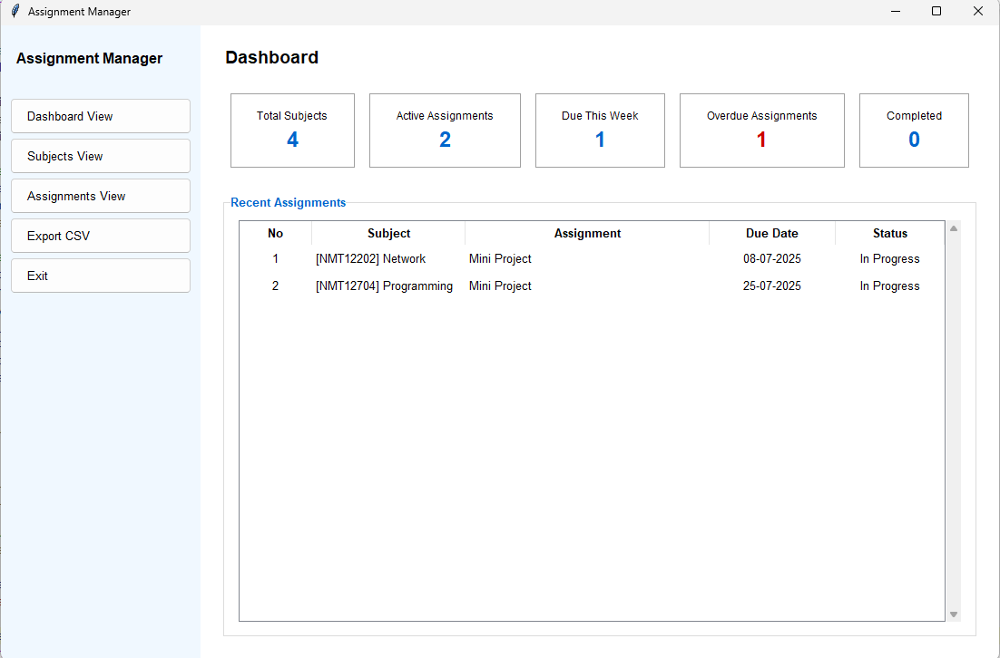
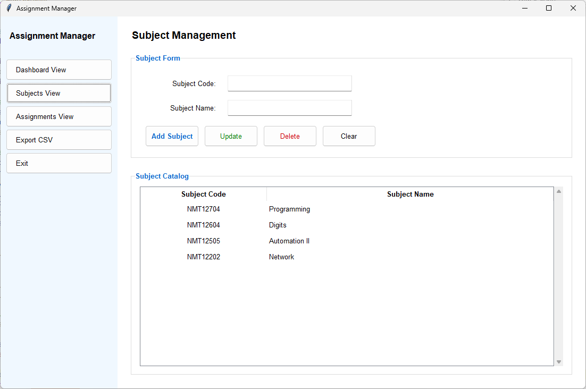
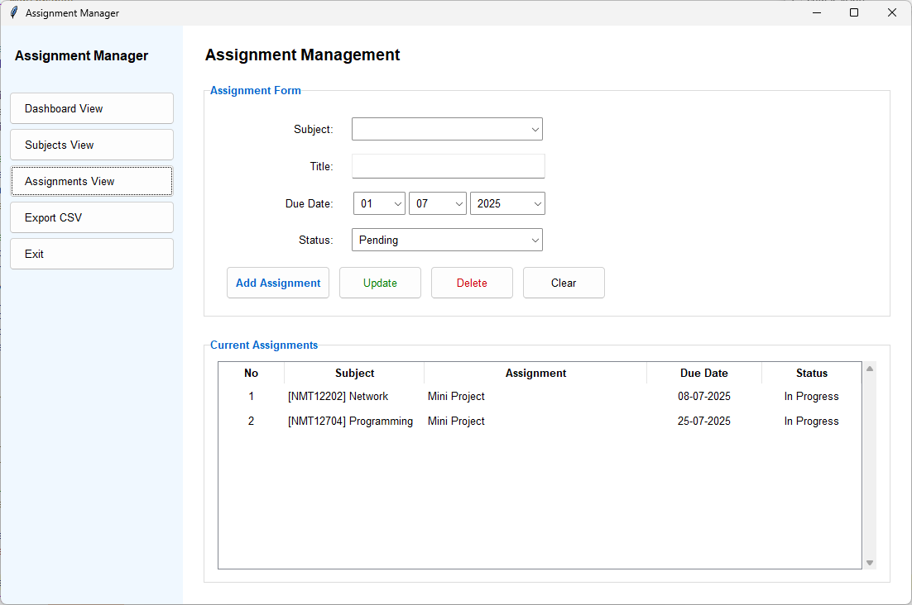
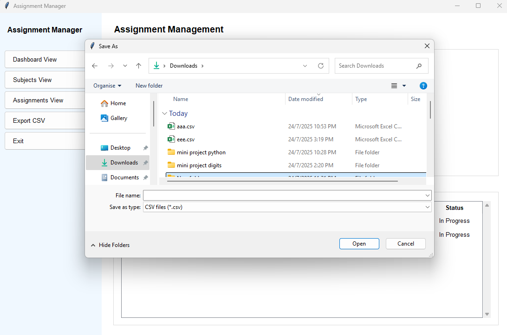
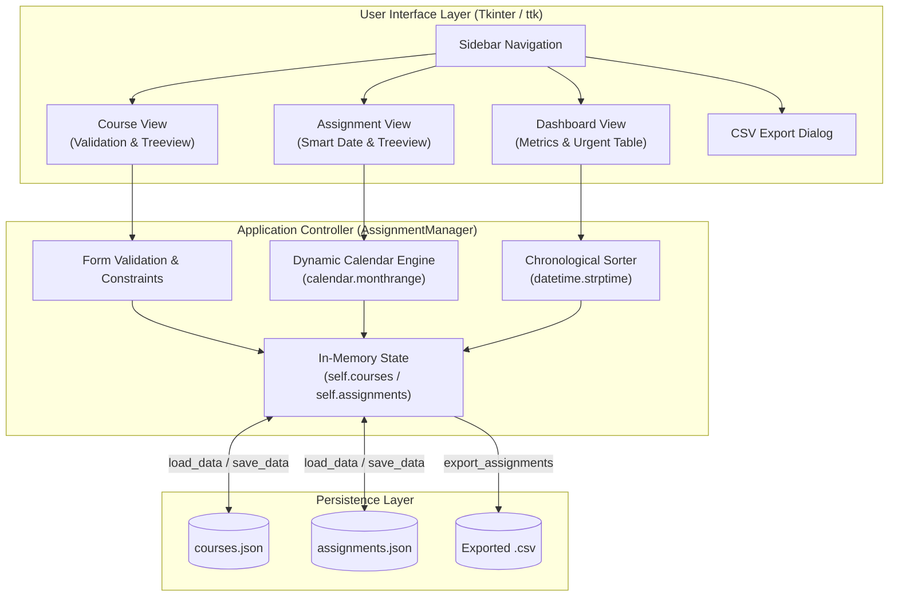

# 📚 Academic Assignment Management System (Python GUI)

[](https://www.python.org/)
[]()
[]()
[]()
[]()

> Developed for **NMT12704: System Programming Technology II**, Faculty of Electronic Engineering Technology, Universiti Malaysia Perlis (UniMAP).

---

## 📌 Project Overview

The **Academic Assignment Management System** is a lightweight, responsive desktop application developed to streamline deadline tracking, workload scheduling, and course-specific task organization for university students.

Built natively in Python using the **Tkinter / ttk** graphical subsystem, the software delivers a rich desktop user experience without requiring heavy third-party GUI frameworks or external database daemons. All data is structured with atomic JSON persistence and offers one-click CSV report exporting.

<div align="center">
  
  <p><em>Figure 1: Executive Dashboard with Real-Time Statistics Counters and Urgent Deadlines</em></p>
</div>

### Application Modules & Workflow

| 1. Course Management | 2. Assignment Tracker | 3. CSV Report Export |
|:---:|:---:|:---:|
| <br/><b>Subject Validation & CRUD</b> | <br/><b>Dynamic Calendar & Priority Tracking</b> | <br/><b>Audit Trail & Data Portability</b> |

---

## ✨ Key Features & Capabilities

- **Unified Academic Dashboard:**
  - Real-time statistics counters: *Total Courses*, *Total Assignments*, *Pending Tasks*, and *Completed Tasks*.
  - Priority-ordered task feed displaying the top 10 most urgent deadlines sorted dynamically using `datetime.strptime`.
  - Double-click item inspection modal dialog detailing comprehensive course and assignment metadata.
- **Complete Subject (Course) Management:**
  - Create, Read, Update, and Delete (CRUD) operations for academic modules.
  - Strict input validation enforcing unique, capitalized subject codes (e.g., `NMT12704`, `CS101`).
- **Smart Assignment Tracker:**
  - Linked foreign-key relationship tying assignments directly to active course codes.
  - **Dynamic Calendar Engine:** Day dropdown automatically computes exact valid calendar days using `calendar.monthrange(year, month)`—preventing impossible dates (e.g., February 30 or non-leap February 29).
  - Multi-state lifecycle tracking: `Pending`, `In Progress`, and `Completed`.
- **Data Persistence & Portability:**
  - Automatic session saving to structured JSON storage (`courses.json` and `assignments.json`).
  - Native file dialog CSV exporter for academic reporting, grading verification, and external spreadsheet analysis.
- **Zero Third-Party Dependencies:**
  - Implemented entirely with Python's built-in standard libraries (`tkinter`, `json`, `csv`, `datetime`, `calendar`, `os`).

---

## 🏗️ Software Architecture & Data Flow

<div align="center">

<details>
<summary align="center"><b>📐 Click to expand Application Architecture Diagram</b></summary>

<br/>



</details>

</div>

---

## 🎨 UI/UX Design System

The application features a modern, accessible interface adhering to clean visual hierarchy:
- **Primary Color:** Professional Blue (`#0066cc`) for active headers and action buttons.
- **Sidebar Background:** Light Ice Blue (`#f0f8ff`) for distinct visual separation.
- **Action Semantics:** Clear visual differentiation with Green (`#008000`) for confirmation and Red (`#cc0000`) for destructive delete operations.
- **Responsive Layout:** Minimum geometry constraint of `1000x600` ensures all tables and forms render legibly across different screen resolutions.

---

## 📁 Repository Structure

```
PYTHON_AssignmentManagementApplication/
├── assets/                           # Application GUI screenshots
│   ├── python_dashboard.png
│   ├── python_courses.png
│   ├── python_assignments.png
│   └── python_export.png
├── src/
│   ├── AssignmentManagement.py       # Main application source code (Tkinter GUI & logic)
│   ├── assignments.json              # Sample assignment database schema
│   └── courses.json                  # Sample course curriculum schema
└── README.md                         # Repository documentation
```

---

## 🚀 Getting Started

### Prerequisites
- **Python 3.8** or higher installed on your system.
- *No pip packages required!* The application uses standard Python modules:
  ```python
  import tkinter as tk
  from tkinter import ttk, messagebox, filedialog
  import csv, json, os
  from datetime import datetime, timedelta
  from calendar import monthrange
  ```

### Running the Application

1. Clone or download this repository:
   ```bash
   git clone https://github.com/aziziyahya/PYTHON_AssignmentManagementApplication.git
   cd PYTHON_AssignmentManagementApplication
   ```

2. Launch the application:
   ```bash
   python src/AssignmentManagement.py
   ```
   *(Or on Windows, simply double-click `AssignmentManagement.py`).*

3. Data will automatically initialize from `src/courses.json` and `src/assignments.json` or create fresh data stores upon first launch.

---

## 👥 Project Contributors

Developed as part of **NMT12704: System Programming Technology II** within the **Industrial Electronic Automation Programme**, Faculty of Electronic Engineering Technology, **Universiti Malaysia Perlis (UniMAP)**:

| Contributor | Matric ID | Focus Area |
|---|---|---|
| **Nik Mohamad Azizi Bin Nik Yahya** | `241503239` | Application Architecture & Logic |
| **Afifah Nadhirah Binti Selbini** | `241501822` | Layout Design & Documentation |
| **Nisa Liyana Asmadi** | `241501842` | Layout Design & Documentation |

*Faculty of Electronic Engineering Technology, Universiti Malaysia Perlis*

